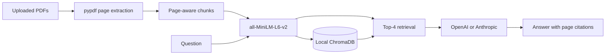

# DocChat

DocChat is a local PDF question-answering app built with Streamlit. Upload one or more PDFs, index their text locally, and ask questions about what you uploaded. Answers are generated from retrieved page chunks and include page citations. When the retrieved text cannot answer a question, the app returns a clear not-found response instead of guessing.

Screenshot: `docs/screenshot.png` (add this after capturing the running app)

Live demo: to be added

## Architecture



## Setup

This project targets Python 3.11+ and was developed in a virtual environment. The commands below work in a fresh WSL Ubuntu shell.

```bash
git clone <your-repository-url>
cd docchat
python3 -m venv .venv
source .venv/bin/activate
pip install -r requirements.txt
cp .env.example .env
```

Edit `.env` and set `LLM_PROVIDER` to `openai` or `anthropic`, then add the matching key. Embeddings do not require an API key; the model downloads from Hugging Face on first use.

```bash
streamlit run app.py
```

Open the local URL Streamlit prints, upload PDFs, select **Index uploaded PDFs**, then ask a question. Two self-written PDFs in `sample_docs/` are included for a quick demo.

## Design decisions

- **Local embeddings:** `all-MiniLM-L6-v2` keeps document vectors on the machine and avoids a paid embedding dependency.
- **Page-aware chunks:** chunks stay within a page and use a 700-character window with 120 characters of overlap. That makes citations reliable while keeping nearby context together.
- **Chroma:** Chroma provides a small persistent local vector store with cosine search and no service to provision.
- **Provider boundary:** `docchat/llm.py` isolates the small provider difference so the rest of the app does not depend on one LLM vendor.

## Evaluation results

Run the bundled evaluation with:

```bash
python evals/run_evals.py
```

The latest local run scored **15/15 (100%) retrieval hit rate at top-4** and **15/15 (100%) evidence keyword check** on 15 questions written against the two sample PDFs. Full per-question results are in [evals/results.md](evals/results.md). The answer check is intentionally offline: it verifies expected keywords in retrieved evidence, so it is a useful regression signal but not a replacement for human review or an LLM judge.

## Known limitations

- Scanned PDFs without an OCR text layer are detected and skipped; OCR is not included.
- Tables, multi-column pages, and visual layouts can extract in an unhelpful reading order.
- Very long documents may need tuning for chunk size, retrieval depth, and local storage. The app limits individual uploads to 25 MB.
- An LLM provider key is still needed to turn retrieved text into prose answers.

## Deployment

See [DEPLOY.md](DEPLOY.md) for Streamlit Community Cloud and Hugging Face Spaces steps.

## What I learned

Author will fill this in.
